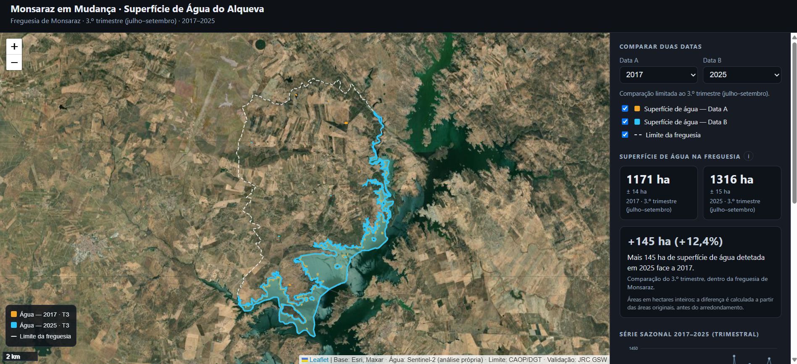
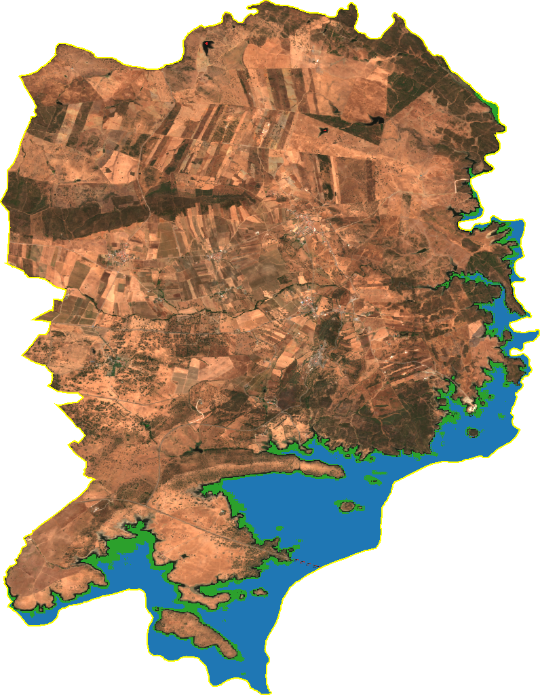
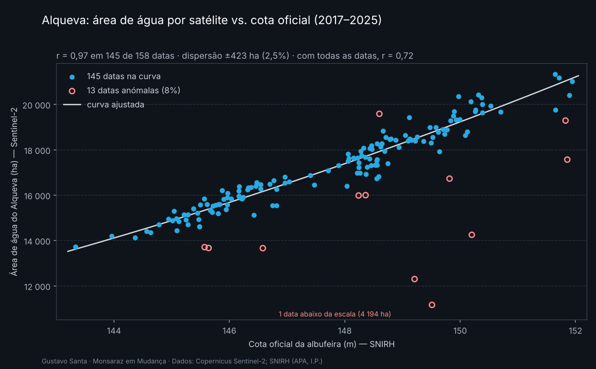

# Monsaraz em Mudança — Superfície de Água do Alqueva

A reproducible geospatial pipeline and web application that tracks the change in the
**Alqueva reservoir's water surface within the parish (*freguesia*) of Monsaraz**, Portugal,
from Copernicus Sentinel-2 imagery (2017–2025).

**Live demo:** https://gustavosanta-star.github.io/monsaraz-agua-alqueva/



---

## Overview

The application lets anyone compare the **Q3 (July–September) water surface** of the parish between
any two years: the delineated water extent on a satellite basemap, the area of each date, the
absolute and relative difference, a quarterly time series, and a documented methodology.

The engineering goal was a pipeline where **adding a new date is a single function call** — not a
manual GIS session — with reproducible analysis, documented indicators and quality control.

Between the lowest and highest Q3 values in the series, the parish's water surface grew by
~276 ha (+27%); the change map below shows **where** it grew (green = water gained, 2020 → 2025):



## Study area

Freguesia de **Monsaraz** (municipality of Reguengos de Monsaraz, Évora district), on the right
bank of the Guadiana / Alqueva reservoir. Official boundary from **CAOP (DGT)**. Area ≈ 8,829 ha.
The large body of the Alqueva lies mostly outside the parish; the indicator measures only the water
**inside the administrative boundary**.

## Data & method

| Step | Choice |
|------|--------|
| Imagery | Copernicus **Sentinel-2 L2A** (10 m), via Google Earth Engine |
| Temporal composite | Per-quarter **median**, with cloud/shadow masking (Sentinel-2 **SCL** band) |
| Water detection | **MNDWI** = (B3 − B11) / (B3 + B11), threshold **0** |
| Post-processing | Vectorization + 10 m simplification |
| Areas | Computed in **ETRS89/PT-TM06** (EPSG:3763); served in WGS84 |

## Consistency check — JRC Global Surface Water

Comparison with **JRC Global Surface Water** (Pekel et al., 2016), the EU reference dataset for
surface water. JRC GSW is itself derived from **optical imagery (Landsat)**, so agreement shows
**cross-sensor consistency, not independent validation**: two optical methods can share the same
errors. The independent test is the area–water level comparison below.

- **Spatial agreement (IoU): 92.7%** — July 2020, compared only over JRC-observed pixels, at 30 m.
- **Temporal correlation (Pearson r): 0.80** — 41 months (2017–2021) with >80% JRC coverage, areas
  compared over the same observed pixels, at 30 m.

## Independent validation — official water level (SNIRH)

A reservoir's flooded area is a rising function of its water level. The official level (*cota*)
and stored volume of the Alqueva are measured at the dam and published by **SNIRH (APA, I.P.)** —
a source that has nothing to do with satellite imagery. For this test the method was applied to the
**whole Alqueva** (including the Spanish part, within the JRC-derived reservoir envelope, 24,596 ha),
on **single-date** Sentinel-2 images, each paired with the official level of the same day (±3 days).



**Area vs. level (Phase 1).** Of 851 image dates (2017–2025), **158** show the reservoir with
< 50 ha of cloud gaps and have a level record.

- **145 of the 158 dates follow the area–level curve: r = 0.97** (quadratic fit, R² = 0.94),
  with a scatter of **±423 ha (2.5%)** for a single image.
- The other **13 (8%)** are flagged as probable classification errors (haze, thin cloud, turbid
  water) by robust rejection (residual > 3.5 × MAD); 12 of them fall *below* the curve. They are kept
  and marked, not deleted. **With all 158 dates, r = 0.72.** Both numbers are reported.

**Volume (Phase 2).** In a reservoir, dV = A · dh, so the satellite area can be integrated over the
level to estimate volume changes, and compared with the official volume–level relation (dV/dh):

- The satellite area is **~92% of the area implied by the official volume data**, with a nearly
  constant ratio (0.91–0.94) across 144–151 m: a systematic underestimate, most likely from
  shoreline mixed pixels and flooded vegetation that MNDWI does not classify as water.
- Volume change between 143.1 m and 152.0 m: **1,510 hm³ (satellite) vs 1,630 hm³ (official)**.
- Volume series rebuilt from **one** reference volume (2023-07-10) plus the satellite curve,
  against 450 official records: mean error −37 hm³, **RMSE 59 hm³ (1.8%)**.
- Note: the commonly quoted **25,000 ha** at full supply level (152 m) is not consistent with the
  official volume data themselves, whose dV/dh implies ~21,500 ha at 151 m — close to the
  satellite curve (~20,200 ha at 151 m; ~21,200 ha at 152 m).

The satellite measures **volume changes, not absolute volume**: it cannot see the reservoir bed, so
an absolute series needs one reference volume.

## Phase 3 — ten Guadiana reservoirs: volume from a single image

The method was extended to the ten Portuguese reservoirs of the Guadiana basin with daily water level in SNIRH
(`albufeiras.json`: adding a reservoir is one line). Each reservoir gets an envelope from the JRC maximum
water extent (steps 13–15), and three things changed in the method after the multi-reservoir test:

1. **Water index.** The original MNDWI at 20 m measured only 54–92% of the area implied by the official volume
   curve: it misses the shoreline band (shallow, turbid or vegetated water). **NDWI (B3, B8; native 10 m) > −0.1**
   brings it to 0.98–1.01 in the Alqueva and the Caia. The threshold was calibrated on those two only; the other
   eight are a test, not a fit (steps 18–19).
2. **Automatic image filter (no water level used).** The low-water core of each reservoir, from a Sentinel-2
   median of its lowest 60-day window of 2017–2025, must be seen as water in ≥ 98%. A first version with a JRC
   "permanent water" core wrongly rejected real droughts (Caia, autumn 2019); the Sentinel-2 core does not
   (steps 17, 17b).
3. **Official level validated.** Automatic level gauges have faults (multi-week drifts, jumps of several metres).
   A date is used only if its level is consistent with the official volume or with neighbouring days (step 20).

**Result** — volume from one image (area → level → volume), leave-one-year-out, filter only:

| Reservoir | Area (ha) | Satellite / official area | r | Volume error (% of mean) | Old method |
|---|---|---|---|---|---|
| Alqueva | 24,603 | 1.01 | 0.99 | **2.2%** | 3.4% |
| Abrilongo | 284 | 0.83 | 0.99 | **4.0%** | 14.3% |
| Odeleite | 752 | 0.94 | 0.99 | **4.8%** | 16.0% |
| Monte Novo | 322 | 0.90 | 0.98 | **5.4%** | 15.9% |
| Beliche | 297 | 0.99 | 0.99 | **5.7%** | 20.4% |
| Enxoé | 183 | 0.67 | 0.97 | **6.6%** | 12.8% |
| Caia | 1,866 | 0.98 | 0.98 | **7.1%** | 8.3% |
| Lucefécit | 177 | 0.83 | 0.95 | 18.6% | 20.0% |
| Vigia | 310 | — (official curve inconsistent) | 0.97 | 28.0% | 54.3% |
| Pedrógão | 1,211 | — (no volume in SNIRH) | 0.95 | — | — |

**Limits.** Enxoé stays at 67% of the official area at all levels (outdated official curve or aquatic
vegetation — not resolved). Lucefécit and Vigia have a tiny or no core and a noisy official level, so their error
does not measure the method alone. The NDWI threshold and the 98% filter threshold were chosen after seeing the
Alqueva data. The satellite measures volume changes; absolute volume needs one reference value.

## Uncertainty

Two terms are reported. Neither is a statistical confidence interval.

1. **Threshold sensitivity:** area change for a ±0.05 shift of the MNDWI threshold — mean
   ≈ ±15 ha (~1.3%).
2. **Shoreline (mixed-pixel) term:** MNDWI uses B11, native **20 m**. Shoreline length inside the
   parish, counted on the 20 m grid, is **46–54 km**. Worst case — every edge pixel biased by half
   a pixel in the same direction — gives **±46–54 ha (~4%)**; with independent errors it is
   **<1 ha**. The threshold term falls between the two.

A systematic edge bias affects both dates in the same direction and largely cancels in a
difference. Even under the most conservative assumption (opposite biases, added linearly), the
2020 → 2025 change (+276 ha) exceeds the combined ±100 ha; small differences such as
2022 → 2023 (+35 ha) do not, and the app flags them as within the uncertainty.

## Quality checks

- **Non-reservoir water** (farm ponds, small dams): isolated using a reservoir envelope built from
  the JRC GSW maximum water extent (largest connected body, ≥ ~92 ha, dilated 30 m). It accounts for
  **0.2–1.0 ha in Q3 (<0.1%)** — negligible, so it is reported rather than removed. Many ponds are
  not detected at all in Q3 (dry, turbid or vegetated).
- **Cloud gaps:** ~0.1% of the parish without valid data in every quarterly composite.

## Limitations

- **Fixed MNDWI threshold (0)** — not scene-adaptive (turbidity, sun angle).
- The **quarterly median smooths** within-quarter water-level changes: each value is a *typical*
  extent, not a single instant.
- The dominant area uncertainty is at the **shoreline**: MNDWI uses B11 (native **20 m**), so mixed
  edge pixels along this very irregular shoreline may weigh as much as the threshold choice.
- The uncertainty terms cover the **threshold and shoreline mixed pixels** only; geolocation,
  radiometric and temporal-mixing errors are not quantified.
- The JRC comparison is optical-vs-optical (independent validation is the SNIRH test). Its scope is
  limited: the IoU is a single date; *r* covers 2017–2021 only (the JRC monthly series ends in
  2021); the >80%-coverage filter biases toward clearer months; and part of *r* reflects the
  **shared seasonal cycle** of both series.
- **Area–level test:** ~8% of single-date images are anomalous and must be filtered; the satellite
  area is ~8% below the area implied by official volume data (systematic, nearly constant).
- **Volume:** only **changes** in volume are estimated; an absolute value needs a reference volume.
- **Administrative boundary:** from a WFS-derived CAOP GeoJSON; the exact CAOP edition is
  unconfirmed. The parish geometry is stable since the 2013 reorganization.
- The water area is a **proxy for the system state**, driven by both rainfall and reservoir
  management — the comparison describes differences, it does **not** attribute their causes.

## Reproduce

Requires a free (non-commercial) **Google Earth Engine** account and Cloud project.

```bash
pip install -r requirements.txt
earthengine authenticate
```

Set your Earth Engine project id in the scripts, then run in order:

| Script | Does |
|--------|------|
| `01_explorar.py` | GEE connectivity + first Sentinel-2 preview |
| `02_agua.py` | Parish boundary + MNDWI water + area |
| `03_serie.py` | Annual summer series |
| `04_trimestral.py` | Quarterly series with cloud masking + coverage flag |
| `05_comparar.py` | Per-year water polygons (GeoJSON) + change map |
| `06_validacao.py` | Consistency check vs JRC GSW (IoU, Pearson r) |
| `07_incerteza.py` | Threshold-sensitivity uncertainty |
| `08_margem.py` | Shoreline length and mixed-pixel uncertainty (20 m grid) |
| `09_envolvente.py` | Quality check: water outside the reservoir envelope (ponds) |
| `10_snirh.py` | Downloads the official Alqueva water level and volume (SNIRH) |
| `11_area_cota.py` | Whole-reservoir water area on single dates + matching official level |
| `12_volume.py` | Area–level curve, anomaly flags, volume comparison (no GEE; plain Python) |
| `12b_validacao_cruzada.py` | Volume from a single image, leave-one-year-out (Alqueva) |
| `13_snirh_guadiana.py` | Official level and volume for all reservoirs in `albufeiras.json` |
| `14_envolventes.py` | Envelope of each reservoir (JRC max extent) + check image |
| `15_area_cota_multi.py` | Water area per date (MNDWI 20 m) + official level, all reservoirs |
| `16_volume_multi.py` | Area–level and volume analysis, original method (superseded by step 20) |
| `17_qualidade_imagem.py`, `17b_nucleo_s2.py` | Automatic image-quality filter (core water test; 17b = final) |
| `18_resolucao.py` | Index/threshold/resolution test on clean dates |
| `19_area_ndwi10.py` | Water area per date with NDWI at 10 m |
| `20_analise_ndwi10.py` | Final analysis: level validation, filter, area ratio, leave-one-year-out volume error |

Serve the web app locally (it reads the generated data files, so it needs a server — not a
double-click):

```bash
python -m http.server 8000
# then open http://localhost:8000
```

## Data sources & credits

- **Copernicus Sentinel-2** (ESA), via Google Earth Engine.
- **JRC Global Surface Water** — Pekel, J.-F., Cottam, A., Gorelick, N. & Belward, A. S. (2016).
  *High-resolution mapping of global surface water and its long-term changes.* Nature 540, 418–422.
- **SNIRH** — Sistema Nacional de Informação de Recursos Hídricos, Agência Portuguesa do Ambiente,
  I.P.: Alqueva water level and volume.
- **CAOP** — Carta Administrativa Oficial de Portugal, Direção-Geral do Território.
- Basemap tiles: Esri, Maxar, Earthstar Geographics.

## Author

**Gustavo Santa** · ORCID [0009-0008-4266-0732](https://orcid.org/0009-0008-4266-0732)

Personal portfolio project. _License: MIT (suggested — add a LICENSE file if you agree)._
