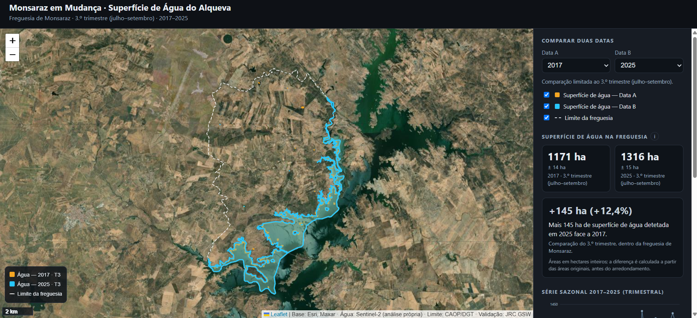
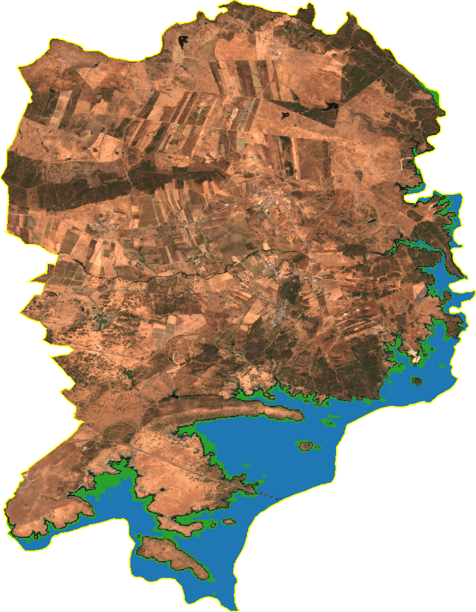
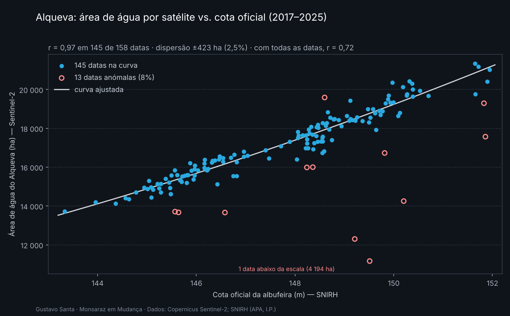

# Monsaraz em Mudança: Superfície de Água do Alqueva

How much of the parish (*freguesia*) of Monsaraz, Portugal, is covered by the Alqueva reservoir, and
how has that changed since 2017? This repository answers that from Copernicus Sentinel-2 imagery
(2017–2025), with a reproducible pipeline and a small web app on top.

Live demo: https://gustavosanta-star.github.io/monsaraz-agua-alqueva/



## Overview

In the app you pick any two years and compare the parish's water surface in Q3 (July–September).
You get the water extent drawn over a satellite basemap, the area on each date, the absolute and
relative difference, a quarterly time series, and the methodology behind it.

I built the pipeline so that adding a new date takes one function call instead of an afternoon in a
GIS. The analysis is reproducible, and the indicators and quality checks are documented below.

Between the lowest and highest Q3 values in the series, the parish's water surface grew by about
276 ha (+27%). The change map shows where (green is water gained between 2020 and 2025):



## Study area

Freguesia de Monsaraz, in the municipality of Reguengos de Monsaraz (Évora district), on the right
bank of the Guadiana and the Alqueva reservoir. The boundary is the official one from CAOP (DGT), and
the parish covers about 8,829 ha. Most of the Alqueva lies outside it, so the indicator counts only
the water inside the administrative boundary.

## Data and method

| Step | Choice |
|------|--------|
| Imagery | Copernicus Sentinel-2 L2A (10 m), via Google Earth Engine |
| Temporal composite | Per-quarter median, with cloud and shadow masking (Sentinel-2 SCL band) |
| Water detection | MNDWI = (B3 − B11) / (B3 + B11), threshold 0 |
| Post-processing | Vectorization and 10 m simplification |
| Areas | Computed in ETRS89/PT-TM06 (EPSG:3763); served in WGS84 |

## Consistency check against JRC Global Surface Water

The first comparison is with JRC Global Surface Water (Pekel et al., 2016), the EU reference dataset
for surface water. JRC GSW also comes from optical imagery (Landsat), so two optical methods can
share the same errors. Agreement here shows the results are consistent across sensors. It does not
count as independent validation; that comes from the water-level test in the next section.

- Spatial agreement (IoU): 92.7% for July 2020, compared only over pixels JRC observed, at 30 m.
- Temporal correlation (Pearson r): 0.80 over 41 months (2017–2021) with more than 80% JRC coverage,
  with areas compared over the same observed pixels, at 30 m.

## Independent validation with the official water level (SNIRH)

The higher a reservoir's water level, the larger its flooded area. The official level (*cota*) and
stored volume of the Alqueva are measured at the dam and published by SNIRH (APA, I.P.), so they owe
nothing to satellite imagery. For this test I applied the method to the whole Alqueva, Spanish part
included, inside the JRC-derived reservoir envelope (24,596 ha). Each single-date Sentinel-2 image
was paired with the official level for the same day (±3 days).



**Area vs. level (phase 1).** Of 851 image dates between 2017 and 2025, 158 show the reservoir with
less than 50 ha of cloud gaps and have a level record.

- 145 of those 158 dates follow the area–level curve closely: r = 0.97 (quadratic fit, R² = 0.94),
  with a scatter of ±423 ha (2.5%) for a single image.
- The remaining 13 (8%) are flagged by robust rejection (residual above 3.5 × MAD) as probable
  classification errors from haze, thin cloud or turbid water. Twelve of them fall below the curve.
  They stay in the data, marked. With all 158 dates, r drops to 0.72, and I report both numbers.

**Volume (phase 2).** In a reservoir, dV = A · dh. Integrating the satellite area over the level
gives volume changes, which can be checked against the official volume–level relation (dV/dh):

- The satellite area is about 92% of the area implied by the official volume data, and the ratio
  barely moves (0.91–0.94) between 144 and 151 m. That points to a systematic underestimate, most
  likely from mixed pixels on the shoreline and flooded vegetation that MNDWI does not call water.
- Volume change between 143.1 m and 152.0 m: 1,510 hm³ from the satellite, 1,630 hm³ official.
- Rebuilding the volume series from a single reference volume (2023-07-10) plus the satellite curve
  and comparing it with 450 official records gives a mean error of −37 hm³ and an RMSE of
  59 hm³ (1.8%).
- The 25,000 ha often quoted for full supply level (152 m) does not match the official volume data:
  their dV/dh implies about 21,500 ha at 151 m. The satellite curve gives about 20,200 ha at 151 m
  and 21,200 ha at 152 m, which is much closer.

A satellite cannot see the reservoir bed, so it measures changes in volume. An absolute series needs
one reference volume.

## Phase 3: volume from a single image in ten Guadiana reservoirs

Next I extended the method to the ten Portuguese reservoirs in the Guadiana basin that have a daily
water level in SNIRH. They are listed in `albufeiras.json`, and adding another takes one line. Each
reservoir gets an envelope from the JRC maximum water extent (steps 13–15). Testing on several
reservoirs led to three changes in the method:

1. **Water index.** MNDWI at 20 m measured only 54–92% of the area implied by the official volume
   curve, because it misses the band of shallow, turbid or vegetated water along the shore. NDWI
   (B3, B8; native 10 m) above −0.1 brings the ratio to 0.98–1.01 in the Alqueva and the Caia. The
   threshold was calibrated on those two reservoirs only, so the other eight work as a test rather
   than a fit (steps 18–19).
2. **Automatic image filter, without using the water level.** I take the low-water core of each
   reservoir from a Sentinel-2 median of its lowest 60-day window in 2017–2025. An image passes if
   at least 98% of that core is seen as water. My first version used a JRC "permanent water" core
   and threw out real droughts (Caia, autumn 2019); the Sentinel-2 core does not (steps 17, 17b).
3. **Checking the official level.** Automatic level gauges fail now and then, with drifts lasting
   weeks and jumps of several metres. A date is used only if its level agrees with the official
   volume or with the neighbouring days (step 20).

Volume from one image (area to level to volume), leave-one-year-out, using only the filter:

| Reservoir | Area (ha) | Satellite / official area | r | Volume error (% of mean) | Old method |
|---|---|---|---|---|---|
| Alqueva | 24,603 | 1.01 | 0.99 | 2.2% | 3.4% |
| Abrilongo | 284 | 0.83 | 0.99 | 4.0% | 14.3% |
| Odeleite | 752 | 0.94 | 0.99 | 4.8% | 16.0% |
| Monte Novo | 322 | 0.90 | 0.98 | 5.4% | 15.9% |
| Beliche | 297 | 0.99 | 0.99 | 5.7% | 20.4% |
| Enxoé | 183 | 0.67 | 0.97 | 6.6% | 12.8% |
| Caia | 1,866 | 0.98 | 0.98 | 7.1% | 8.3% |
| Lucefécit | 177 | 0.83 | 0.95 | 18.6% | 20.0% |
| Vigia | 310 | n/a (official curve inconsistent) | 0.97 | 28.0% | 54.3% |
| Pedrógão | 1,211 | n/a (no volume in SNIRH) | 0.95 | n/a | n/a |

**Limits.** Enxoé stays at 67% of the official area at every level. The cause could be an outdated
official curve or aquatic vegetation; I have not resolved it. Lucefécit and Vigia have a tiny core
or none, and a noisy official level, so their error says as much about the data as about the method.
I chose the NDWI threshold and the 98% filter threshold after seeing the Alqueva data. As before, the
satellite measures volume changes, and absolute volume needs one reference value.

## Uncertainty

I report two terms. Neither is a statistical confidence interval.

1. **Threshold sensitivity.** Shifting the MNDWI threshold by ±0.05 changes the area by about
   ±15 ha on average (~1.3%).
2. **Shoreline mixed pixels.** MNDWI uses B11, which is native 20 m. Counted on the 20 m grid, the
   shoreline inside the parish is 46–54 km long. If every edge pixel were off by half a pixel in the
   same direction, the area would be off by ±46–54 ha (~4%). With independent errors the effect is
   under 1 ha. The threshold term sits between the two.

A systematic edge bias pushes both dates the same way, so it mostly cancels out in a difference.
Even with the most conservative assumption (opposite biases, added linearly), the 2020 to 2025 change
of +276 ha is larger than the combined ±100 ha. Small differences, such as +35 ha between 2022 and
2023, are not, and the app marks them as within the uncertainty.

## Quality checks

- **Water outside the reservoir** (farm ponds, small dams) is separated using a reservoir envelope
  built from the JRC GSW maximum water extent: the largest connected body, at least ~92 ha, dilated
  by 30 m. It amounts to 0.2–1.0 ha in Q3 (under 0.1%), so I report it instead of removing it. Many
  ponds are not detected at all in Q3 because they are dry, turbid or overgrown.
- **Cloud gaps** cover about 0.1% of the parish in every quarterly composite.

## Limitations

- The MNDWI threshold is fixed at 0 and does not adapt to the scene (turbidity, sun angle).
- The quarterly median smooths out level changes within the quarter, so each value is a typical
  extent for those three months, not a single moment.
- Most of the area uncertainty comes from the shoreline. MNDWI uses B11 (native 20 m), and along a
  shoreline this irregular the mixed edge pixels may matter as much as the choice of threshold.
- The uncertainty terms cover only the threshold and the shoreline mixed pixels. Geolocation,
  radiometric and temporal-mixing errors are not quantified.
- The JRC comparison is optical against optical; the independent check is the SNIRH test. Its scope
  is also narrow: the IoU is for one date, r covers only 2017–2021 (the JRC monthly series ends in
  2021), the 80% coverage filter favours clearer months, and part of r comes from the seasonal cycle
  both series share.
- In the area–level test, about 8% of single-date images are anomalous and have to be filtered out,
  and the satellite area runs about 8% below the area implied by the official volume data, a nearly
  constant, systematic gap.
- Only changes in volume are estimated. An absolute value needs a reference volume.
- The parish boundary comes from a CAOP GeoJSON derived from WFS, and I have not confirmed the exact
  CAOP edition. The parish geometry has not changed since the 2013 reorganization.
- The water area reflects the state of the system, which depends on rainfall and on how the
  reservoir is managed. The comparison describes differences; it does not say what caused them.

## Reproduce

You need a free (non-commercial) Google Earth Engine account and a Cloud project.

```bash
pip install -r requirements.txt
earthengine authenticate
```

Set your Earth Engine project id in the scripts, then run them in order:

| Script | What it does |
|--------|------|
| `01_explorar.py` | GEE connectivity + first Sentinel-2 preview |
| `02_agua.py` | Parish boundary + MNDWI water + area |
| `03_serie.py` | Annual summer series |
| `04_trimestral.py` | Quarterly series with cloud masking + coverage flag |
| `05_comparar.py` | Per-year water polygons (GeoJSON) + change map |
| `06_validacao.py` | Consistency check vs JRC GSW (IoU, Pearson r) |
| `07_incerteza.py` | Threshold-sensitivity uncertainty |
| `08_margem.py` | Shoreline length and mixed-pixel uncertainty (20 m grid) |
| `09_envolvente.py` | Quality check: water outside the reservoir envelope (ponds) |
| `10_snirh.py` | Downloads the official Alqueva water level and volume (SNIRH) |
| `11_area_cota.py` | Whole-reservoir water area on single dates + matching official level |
| `12_volume.py` | Area–level curve, anomaly flags, volume comparison (no GEE; plain Python) |
| `12b_validacao_cruzada.py` | Volume from a single image, leave-one-year-out (Alqueva) |
| `13_snirh_guadiana.py` | Official level and volume for all reservoirs in `albufeiras.json` |
| `14_envolventes.py` | Envelope of each reservoir (JRC max extent) + check image |
| `15_area_cota_multi.py` | Water area per date (MNDWI 20 m) + official level, all reservoirs |
| `16_volume_multi.py` | Area–level and volume analysis, original method (superseded by step 20) |
| `17_qualidade_imagem.py`, `17b_nucleo_s2.py` | Automatic image-quality filter (core water test; 17b = final) |
| `18_resolucao.py` | Index/threshold/resolution test on clean dates |
| `19_area_ndwi10.py` | Water area per date with NDWI at 10 m |
| `20_analise_ndwi10.py` | Final analysis: level validation, filter, area ratio, leave-one-year-out volume error |

The web app reads the generated data files, so it has to be served rather than opened with a
double-click:

```bash
python -m http.server 8000
# then open http://localhost:8000
```

## Data sources and credits

- Copernicus Sentinel-2 (ESA), via Google Earth Engine.
- JRC Global Surface Water: Pekel, J.-F., Cottam, A., Gorelick, N. & Belward, A. S. (2016).
  *High-resolution mapping of global surface water and its long-term changes.* Nature 540, 418–422.
- SNIRH, Sistema Nacional de Informação de Recursos Hídricos, Agência Portuguesa do Ambiente, I.P.:
  Alqueva water level and volume.
- CAOP, Carta Administrativa Oficial de Portugal, Direção-Geral do Território.
- Basemap tiles: Esri, Maxar, Earthstar Geographics.

## Author

Gustavo Santa · ORCID [0009-0008-4266-0732](https://orcid.org/0009-0008-4266-0732)

A personal portfolio project, released under the MIT License (see `LICENSE`).
