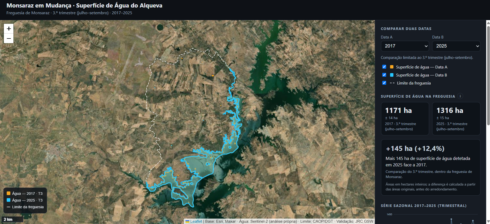
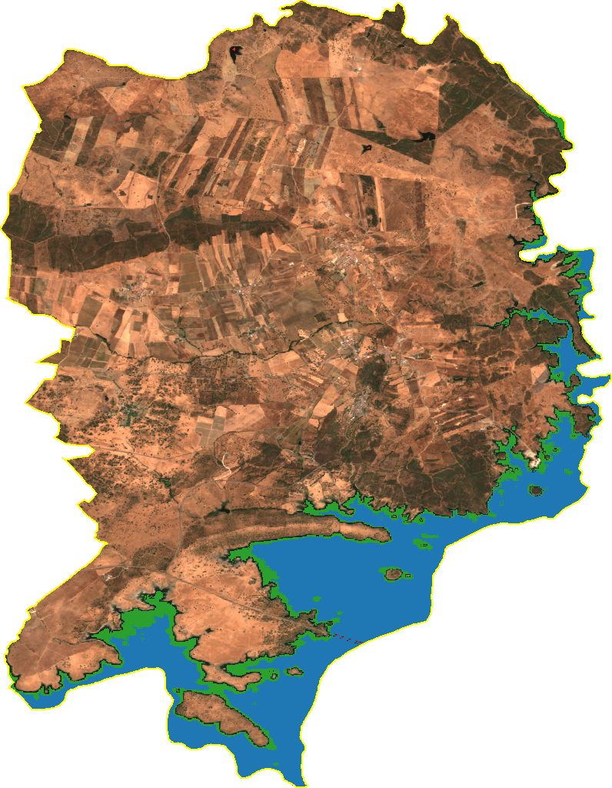

# Monsaraz em Mudança — Superfície de Água do Alqueva

A reproducible geospatial pipeline and web application that tracks the change in the
**Alqueva reservoir's water surface within the parish (*freguesia*) of Monsaraz**, Portugal,
from Copernicus Sentinel-2 imagery (2017–2025).

**Live demo:** https://gustavosanta-star.github.io/monsaraz-agua-alqueva/



---

## Overview

The application lets anyone compare the **late-summer (Q3) water surface** of the parish between
any two years: the delineated water extent on a satellite basemap, the area of each date, the
absolute and relative difference, a quarterly time series, and a documented methodology.

The engineering goal was a pipeline where **adding a new date is a single function call** — not a
manual GIS session — with reproducible analysis, documented indicators and quality control.

Between the driest and wettest late-summers in the series, the parish's water surface grew by
~276 ha (+27%); the change map below shows **where** it grew (green = water gained, 2020 → 2025):



## Study area

Freguesia de **Monsaraz** (municipality of Reguengos de Monsaraz, Évora district), on the right
bank of the Guadiana / Alqueva reservoir. Official boundary from **CAOP (DGT)**. Area ≈ 8,829 ha.
The large body of the Alqueva lies mostly outside the parish; the indicator measures only the water
**inside the administrative boundary**.

## Data & method

| Step | Choice |
|------|--------|
| Imagery | Copernicus **Sentinel-2 L2A** (10 m), via Google Earth Engine |
| Temporal composite | Per-quarter **median**, with cloud/shadow masking (Sentinel-2 **SCL** band) |
| Water detection | **MNDWI** = (B3 − B11) / (B3 + B11), threshold **0** |
| Post-processing | Vectorization + 10 m simplification |
| Areas | Computed in **ETRS89/PT-TM06** (EPSG:3763); served in WGS84 |

## Validation — against JRC Global Surface Water

Independent benchmark: **JRC Global Surface Water** (Pekel et al., 2016), the EU reference dataset
for surface water. It is itself satellite-derived (Landsat), so it is an **independent reference,
not ground truth**.

- **Spatial agreement (IoU): 92.7%** — July 2020, compared only over JRC-observed pixels, at 30 m.
- **Temporal correlation (Pearson r): 0.80** — 41 months (2017–2021) with >80% JRC coverage, areas
  compared over the same observed pixels, at 30 m.

## Uncertainty

Each area carries a **± band = the sensitivity of the area to a ±0.05 shift of the MNDWI
threshold** (mean ≈ ±15 ha, ~1.3%). It measures **robustness to the threshold choice** — it is
**not** a statistical confidence interval, and it does not capture classification, geolocation or
temporal-mixing error.

## Limitations

- **Fixed MNDWI threshold (0)** — not scene-adaptive (turbidity, sun angle).
- The **quarterly median smooths** within-quarter water-level changes: each value is a *typical*
  extent, not a single instant.
- The dominant area uncertainty is at the **shoreline** (mixed 10 m pixels), scaling with perimeter.
- The **± captures threshold robustness only** — a lower bound of the total uncertainty.
- **Validation scope:** the IoU is a single date; *r* is limited to 2017–2021 (the JRC monthly
  series ends in 2021), so **2022–2025 are not independently validated**; the >80%-coverage filter
  biases toward clearer months; and part of *r* reflects the **shared seasonal cycle** of both series.
- **Administrative boundary:** from a WFS-derived CAOP GeoJSON; the exact CAOP edition is
  unconfirmed. The parish geometry is stable since the 2013 reorganization.
- The water area is a **proxy for the system state**, driven by both rainfall and reservoir
  management — the comparison describes differences, it does **not** attribute their causes.

## Reproduce

Requires a free (non-commercial) **Google Earth Engine** account and Cloud project.

```bash
pip install -r requirements.txt
earthengine authenticate
```

Set your Earth Engine project id in the scripts, then run in order:

| Script | Does |
|--------|------|
| `01_explorar.py` | GEE connectivity + first Sentinel-2 preview |
| `02_agua.py` | Parish boundary + MNDWI water + area |
| `03_serie.py` | Annual summer series |
| `04_trimestral.py` | Quarterly series with cloud masking + coverage flag |
| `05_comparar.py` | Per-year water polygons (GeoJSON) + change map |
| `06_validacao.py` | Validation vs JRC GSW (IoU, Pearson r) |
| `07_incerteza.py` | Threshold-sensitivity uncertainty |

Serve the web app locally (it reads the generated data files, so it needs a server — not a
double-click):

```bash
python -m http.server 8000
# then open http://localhost:8000
```

## Data sources & credits

- **Copernicus Sentinel-2** (ESA), via Google Earth Engine.
- **JRC Global Surface Water** — Pekel, J.-F., Cottam, A., Gorelick, N. & Belward, A. S. (2016).
  *High-resolution mapping of global surface water and its long-term changes.* Nature 540, 418–422.
- **CAOP** — Carta Administrativa Oficial de Portugal, Direção-Geral do Território.
- Basemap tiles: Esri, Maxar, Earthstar Geographics.

## Author

**Gustavo Santa** · ORCID [0009-0008-4266-0732](https://orcid.org/0009-0008-4266-0732)

Personal portfolio project. _License: MIT (suggested — add a LICENSE file if you agree)._
